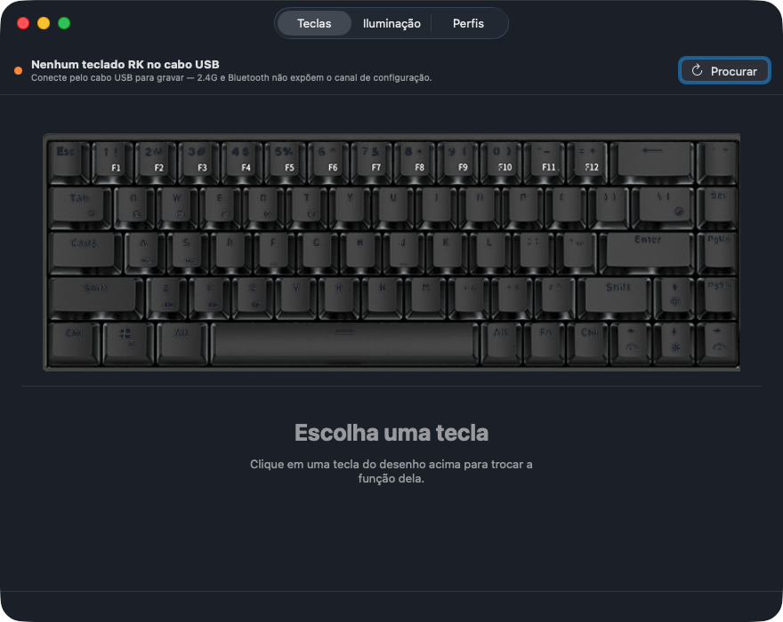

# RK G68 para macOS

[English](README.md) · **Português**

Configurador do teclado **Royal Kludge G68** no Mac — o que a RK só entrega
para Windows. Remapeia teclas, controla a iluminação RGB e guarda perfis, tudo
gravado no firmware do teclado.



Vem em duas formas, sobre o mesmo núcleo:

- **RK G68.app** — app nativo em SwiftUI, com ícone na barra de menus.
- **rkg68** — CLI, para scriptar e para diagnóstico.

## Estado

| Recurso | Situação |
|---|---|
| Remapear teclas | ✅ funciona |
| Camada de mídia e brilho (⏯ 🔊 🔆) | ✅ via remap, com os códigos que o macOS entende |
| Iluminação: efeito, brilho, velocidade, cor, sleep | ✅ funciona |
| Cor por tecla (modo *Customize*) | ✅ funciona |
| Perfis em disco | ✅ funciona |
| Ajuste de branco (ganho por canal, com carga e posição) | ✅ funciona |
| Paleta de cores validadas (presets) | ✅ funciona — só no CLI |
| Cor sólida uniforme (`solid`) | ✅ funciona |
| Conjuntos Jogo / Escritório da RK | ✅ funciona |
| Macros no firmware | ❌ o protocolo de macro da RK nunca foi decifrado — ver *Limitações* |
| Macros por software (no Mac) | ✅ funciona — aba Macros do app |

## Instalação

Requer macOS 14+ e as Command Line Tools da Apple (`xcode-select --install`).
Não precisa do Xcode completo.

```bash
./build-app.sh
cp -R "build/RK G68.app" /Applications/      # ou ~/Applications

# opcional, para o CLI — o binário e a árvore de definições da RK
sudo cp build/rkg68 /usr/local/bin/
sudo mkdir -p /usr/local/share/rkg68 && sudo cp -R build/rk /usr/local/share/rkg68/rk
```

> O `rkg68` não embute os arquivos da RK: ele procura a árvore `rk/` ao lado do
> binário, em `<prefixo>/share/rkg68/rk` e, por último, dentro do `RK G68.app`
> instalado. Se o app já está em `/Applications` ou `~/Applications`, copiar só
> o binário também funciona; sem nenhum dos três ele falha com *"Pasta de
> recursos da RK não encontrada"*. `RKG68_RESOURCES=<caminho>/rk` força a cópia
> que ele deve usar.

> **Não rode o app de dentro de `~/Documents`, `~/Desktop` ou `~/Downloads`.**
> O macOS exibe um pedido de acesso a essas pastas e o app fica esperando a
> resposta. Instale em `/Applications` ou `~/Applications`.

### Monitoramento de Entrada

O macOS só deixa abrir uma collection HID de um dispositivo que se declara
teclado — inclusive a de configuração — para quem tem **Monitoramento de
Entrada**. Na primeira vez que o app encontra o teclado ele pede a autorização;
basta aceitar. Sem ela o IOKit devolve `kIOReturnNotPermitted` e aparece
*"O macOS negou o acesso ao dispositivo HID"*.

Se o erro insistir, é porque a resposta já está gravada como recusa e o sistema
não pergunta de novo:

```bash
tccutil reset ListenEvent com.kauampinheiro.rkg68   # e abra o app outra vez
```

Ou marque o app à mão em Ajustes do Sistema › Privacidade e Segurança ›
Monitoramento de Entrada.

**A autorização não sobrevive a um build com mudança de código.** Sem
identidade de desenvolvedor a assinatura é ad-hoc, e o macOS amarra a permissão
ao hash dela — que muda junto com o código. A caixa continua marcada na lista e
mesmo assim o acesso é negado. Por isso o `build-app.sh` zera o registro a cada
build: assim o app volta a pedir, em vez de falhar calado. Uma identidade de
assinatura própria (mesmo autoassinada) resolveria de vez.

O CLI não tem autorização própria: ele herda a de quem o chama, ou seja a do
**Terminal**. `rkg68 scan` mostra em que pé está.

## Uso

### O app

1. Conecte o G68 **pelo cabo USB** — não pelo dongle 2.4G nem por Bluetooth.
   Só o cabo expõe o canal de configuração; o dongle aparece no Mac como
   `2.4G Wireless Receiver` (Compx `0x25A7`) e o app não o enxerga.
2. Abra o app: o cabeçalho mostra o modelo detectado.
3. **Teclas** — clique na tecla do desenho, escolha a nova função, pronto: já
   foi gravada no teclado.
4. **Iluminação** — escolha o efeito; só aparecem os controles que aquele
   efeito aceita. No efeito *Customize*, clique nas teclas para pintar.
   *Customize* (modo 14) não é um efeito: ele exibe a tabela de cor por tecla
   gravada no teclado. Ativá-lo sem pintar nada deixa o teclado apagado.
5. **Perfis** — salve combinações e aplique depois pela barra de menus.

### O CLI

```bash
rkg68 scan                         # o teclado está acessível?
rkg68 info                         # modelo, teclas e efeitos disponíveis
rkg68 remap caps=esc               # Caps Lock vira Esc
rkg68 remap lwin=lalt lalt=lwin    # troca ⌘ e ⌥ (layout Windows no Mac)
rkg68 remap f5=volup f6=voldown    # F5/F6 viram volume
rkg68 led 17 --color '#FF6600' --brightness 5
rkg68 led 14 && rkg68 perkey w=#FF0000 a=#FF0000 s=#FF0000 d=#FF0000
rkg68 reset-remap                  # volta ao layout de fábrica
rkg68 keys                         # lista as teclas e seus índices
rkg68 targets volume               # procura funções atribuíveis
rkg68 keyset jogo                  # acende só Esc+WASD+setas, apaga o resto
rkg68 calibrate --preset --white   # ajusta o branco e acende para conferir
rkg68 solid '#FFFFFF'              # cor sólida uniforme, corrigida por posição
rkg68 palette test '#FF8000' '#FF9000' --rows   # candidatos para julgar a olho
rkg68 palette add laranja '#FF9000' --lit 68    # registra a cor aprovada
rkg68 selftest                     # confere o protocolo, sem tocar no teclado
rkg68 dump-buffers remap caps=esc  # mostra os bytes, sem enviar nada
```

## Conjuntos de teclas (Jogo / Escritório)

O `KB.ini` da RK declara dois conjuntos de teclas e uma cor — `GaoshouKey1`,
`GaoshouKey2` e `clrGaoshou`. No software oficial são os botões **Gaming mode**
e **Office mode** da aba Avançado (*gaoshou*, 高手, é "mestre" em chinês).

| Conjunto | Teclas |
|---|---|
| Jogo | Esc, W, A, S, D, ↑, ↓, ←, → |
| Escritório | F1–F3, 1–5, Tab, Q, W, E, R, A, S, D, G, Shift, B, Ctrl, Alt, Espaço, PrtSc, PgUp, PgDn, Home, End |

Não é um comando próprio do protocolo: é **preenchimento da tabela de cor por
tecla**. Acende o conjunto, apaga o resto, e por isso entra junto com o modo
*Customize*. No app ficam em Iluminação › Cor por tecla; pelo CLI,
`rkg68 keyset jogo` ou `rkg68 keyset escritorio`.

As listas vêm em VK do Windows e são as mesmas para a família inteira, então
trazem teclas que um layout de 68 não tem — essas são ignoradas.

## Ajuste de branco

O teclado aciona os três canais com o mesmo PWM, mas os LEDs não rendem igual:
no G68 o verde é o mais fraco, então `#FFFFFF` sai **rosado**. Brilho não
resolve — ele mexe nos três juntos e mantém a proporção errada.

O ajuste é um ganho por canal, sempre ≤ 1: só dá para *abaixar* os canais
fortes até o mais fraco alcançar, nunca empurrar além de 255. Branco calibrado
acende um pouco menos que branco cru; é o preço de ser branco de verdade.

No app fica em **Iluminação › Ajuste de branco**. Pelo CLI:

```bash
rkg68 calibrate --preset --white   # calibração medida no G68, já acesa
rkg68 calibrate --r 0.09 --white   # ainda rosado? baixe mais o vermelho
rkg68 calibrate --reset            # volta a mandar a cor crua
```

Vale para a cor fixa dos efeitos e para a cor por tecla. **Efeitos que geram as
próprias cores** (arco-íris, ondas, etc.) são calculados dentro do firmware e
não passam pelo ajuste. A calibração é da unidade física, então fica fora dos
perfis, em `~/Library/Application Support/RKG68Mac/calibration.json`.

### O ganho não é um número só

Medido neste G68: o ganho que deixa o branco neutro **depende de quantos LEDs
estão acesos**.

| LEDs acesos | vermelho neutro | ganho R |
|---|---|---|
| 1 | 28 | 0.110 |
| 15 | ~46 | 0.180 |
| 68 | 64 | 0.251 |

Os pontos caem em `ganho = base × n^0.19`, que é como a calibração aplica:
`--load-r/-g/-b` guardam o expoente e o `applyLighting` passa a carga do
teclado inteiro, enquanto a cor por tecla conta as teclas pintadas. Sem isso,
calibrar com uma tecla acesa e aplicar com 68 faz o branco virar **ciano**.

E depende da **posição**: com o teclado cheio no branco calibrado, a região das
setas puxa para o rosa e casa com o resto levando o vermelho a `0.76×`.

```bash
rkg68 calibrate --keys 'up,down,left,right' --key-r 0.76
rkg68 calibrate --keys-reset       # apaga as correções por posição
```

A causa é a mesma nos dois eixos: o LED vermelho tem tensão direta de ~2,0 V
contra ~3,0 V do verde e do azul. Onde falta corrente (muitos LEDs acesos) ou
falta tensão (longe do ponto de injeção no trilho), o vermelho é o que ainda
acende com folga.

**Nos modos de cor única a correção por posição não tem onde ser aplicada** —
o firmware recebe uma cor e repete em todos os LEDs. Para cor sólida uniforme,
use o `solid`, que desenha pelo Customize com a tabela compensada:

```bash
rkg68 solid '#FFFFFF'              # branco sólido de verdade, tecla por tecla
```

## Paleta de cores validadas

Três ganhos e um expoente não reproduzem todo matiz. Para o que o modelo não
alcança, o jeito é registrar a cor **aprovada olhando o teclado**:

```bash
rkg68 palette test '#FF8000' '#FF9000' '#FFA000' --rows   # julgue os candidatos
rkg68 palette add laranja '#FF9000' --lit 68 --note 'laranja de verdade'
rkg68 led 17 --color @laranja                             # usa o preset
rkg68 palette list
```

`palette test` acende vários candidatos de uma vez — com `--rows`, um por
fileira física e o teclado cheio; sem `--rows`, um por tecla com carga esparsa.
Comparar lado a lado é mais preciso que julgar um por vez, e o comando já
sugere o `palette add` com o `--lit` certo.

Duas regras no formato do preset, as duas por causa das medições acima:

- guarda o **byte cru**, não a cor pedida — recalibrar não joga fora a
  validação;
- guarda **com quantos LEDs acesos** você julgou — a mesma tripla muda de cor
  com a carga, e o `palette apply` avisa quando a carga de aplicação é outra.

Preset vai ao teclado **sem passar pela calibração**: ele já é o resultado
validado. Fica em `~/Library/Application Support/RKG68Mac/palette.json`.

## Segundo plano e abertura no login

Pelo ícone na barra de menus, três opções:

| Opção | O que faz |
|---|---|
| **Abrir no login** | Registra o app via `SMAppService`. O macOS pode pedir confirmação em Ajustes do Sistema › Geral › Itens de Início — o menu mostra o botão quando é o caso. |
| **Abrir sem janela** | Sobe direto para a barra de menus, sem janela na frente. |
| **Esconder ícone do Dock** | O app vive só na barra de menus (`.accessory`). Vale na hora, sem reiniciar. |

Fechar a janela **não encerra o app** — ele continua na barra de menus. Isso
deixou de ser conforto e virou requisito quando as macros entraram: macro por
software só funciona com o processo vivo. Para encerrar de verdade, use
*Encerrar* no menu da barra.

Clicar no ícone do Dock com a janela fechada traz ela de volta. Em modo
`.accessory` não há ícone no Dock, então o caminho é *Abrir janela…* no menu
da barra.

## Macros

O protocolo de macro da RK nunca foi reproduzido por ninguém — ele vive noutra
família de comandos (`CDev3632::SetMacro`, com CRC e pacotes confirmados), e
decifrá-lo exige capturar o software oficial rodando no Windows. Então **não
dá para gravar macro no teclado**.

O que o app faz é interceptar no macOS: a aba **Macros** escuta a tecla de
gatilho e digita a sequência. Duas diferenças importantes em relação ao remap:

- **Não viaja com o teclado.** O remap fica no firmware e vale em qualquer
  computador; a macro só existe neste Mac, com o app aberto.
- **Exige Acessibilidade**, autorização diferente do Monitoramento de Entrada
  que o acesso HID já usa. O app mostra o estado e tem botão para pedir.

O gatilho é **gravado pressionando a tecla**, não escolhido numa lista: o
layout da RK fala VK do Windows e o event tap fala keycode do macOS, e manter
a tradução entre as duas tabelas seria fonte garantida de erro em tecla morta,
ABNT e modificador. Gravando, o que entra é exatamente o que o sistema vê.

A sequência aceita seis tipos de passo:

| Passo | O que faz |
|---|---|
| **Texto** | Digita. Vai como Unicode, então acento e emoji saem certos sem depender do layout. |
| **Teclas** | Uma combinação (⌘S, ⇥, F5) — o que texto não representa. |
| **URL** | Abre o endereço no navegador padrão. |
| **Aplicativo** | Lança um app; com URL preenchida, abre o endereço **nele**. É assim que se abre uma página no Chrome em vez do navegador padrão. |
| **Shell** | Roda um comando em `/bin/sh`, invisível. Não espera terminar nem mostra saída. |
| **Terminal** | Abre uma janela do Terminal numa pasta e roda o comando ali, com a sessão viva. |
| **Espera** | Pausa em milissegundos — alguns aplicativos perdem eventos logo depois de uma troca de foco. |

Exemplo: para abrir o Gmail no Chrome com uma tecla, a sequência é um passo só
— **Aplicativo** com `Google Chrome` escolhido e `mail.google.com` na URL. Para
cair num projeto com o Claude Code rodando, também um passo — **Terminal** com
a pasta `Desktop/meu-projeto` e o comando `claude`.

O passo **Terminal** escreve um script `.command` e o abre com o Terminal, em
vez de mandar AppleScript. O caminho usual
(`osascript -e 'tell application "Terminal" to do script …'`) funciona, mas
exige a autorização de **Automação** — uma terceira do TCC, além do
Monitoramento de Entrada e da Acessibilidade. O script roda com `zsh -l`: sem
shell de login o `PATH` do usuário não é montado e nada instalado por Homebrew
é encontrado.

Enquanto a macro está ligada, a tecla de gatilho **para de funcionar
normalmente** — ela é engolida antes de chegar ao aplicativo.

## Procedência do protocolo

Os comandos foram conferidos contra duas fontes independentes: o código do
Rangoli e **capturas USB do software oficial da RK**. O mapa de teclas que este
projeto gera é **byte a byte idêntico** ao que o software do fabricante envia
(9/9 buffers, verificado no F68).

Do instalador oficial (`innoextract` + strings do binário) saíram duas coisas
que nenhum projeto open source tem:

- **Restauração de fábrica**: é o buffer de iluminação com `[6] = 0x01`. Esse
  byte é documentado pela comunidade como "reservado, sempre zero" — por isso
  ninguém tinha o comando. Confirmado em capturas de dois modelos.
- **Leitura**: o software oficial chama `HidD_GetFeature`. O teclado responde
  ao report `0x0a`; no G68 devolve um status constante, mas o caminho existe.

O binário também revela três famílias de protocolo convivendo (`CDevRKKB`,
`CDevG5KB`, `CDev3632`) — os modelos mais novos usam CRC e paginação, o que
explica por que não são suportados por nenhum projeto da comunidade.

## Como funciona

O teclado publica várias *collections* HID. A configuração trafega só pela de
**usage page `0x01` / usage `0x80`** (System Control) — a collection de teclado
é reservada pelo sistema. Tudo são *feature reports* de **65 bytes** com report
ID `0x0A`:

| Comando | Buffers | Cabeçalho |
|---|---|---|
| Remap | 9 | `0a 09 <n>` (+ `01 f8` no primeiro) |
| Iluminação | 1 | `0a 01 01 02 29` |
| Cor por tecla | 7 | `0a 07 <n>` (+ `03 7e 01` no primeiro) |

No remap, cada tecla ocupa 4 bytes em `índice × 4` de um espaço contínuo de 585
bytes; na cor por tecla, 3 bytes em `índice × 3`. Os códigos **não são HID
puro**: a RK empacota o usage no byte alto (`hid << 8`), usa bitflags próprios
para modificadores (`0x020000` = Shift esquerdo) e prefixa `0x01000000` nas
teclas de mídia.

O layout, os efeitos disponíveis e a arte de cada modelo saem dos arquivos do
próprio software da RK (`Cfg.ini`, `Dev/<PID>/KB.ini`, `led.xml`), embutidos em
`Sources/RKCore/Resources/rk/`. É por isso que o desenho do teclado bate com o
físico, inclusive nas teclas de tamanho irregular.

PIDs de G68 reconhecidos: `0049`, `0052`, `005C`, `0075`, `00E7`, `013A`
(vendor `0x258A`, SinoWealth).

## Limitações

- **Precisa do cabo USB para gravar.** Em 2.4G e Bluetooth o canal de
  configuração não aparece. Depois de gravado, vale em qualquer modo e em
  qualquer computador — está no firmware, não no app.
- **O teclado não devolve o que está gravado nele.** Nenhum projeto achou um
  comando de leitura. Por isso os perfis em disco são a única memória do que
  foi enviado; se você gravar pelo app oficial no Windows, os perfis daqui não
  acompanham.
- **Macros não ficam gravadas no teclado.** O protocolo nunca foi reproduzido. Mas o binário
  oficial mostra onde ele mora: família `CDev3632` (`CDev3632::SetMacro`,
  `Macro_Buffer_ID`, `MacroBufferNum`, `MacroHasMsKey=0x07`), com um transporte
  próprio — `SendCMD_3632`, com CRC e pacotes confirmados, diferente do
  comando simples de 65 bytes. Fechar isso exige capturar o tráfego do software
  oficial no Windows. A alternativa sem Windows é macro por software no macOS
  (um *event tap* que expande o atalho), que funciona mas não fica gravado no
  teclado.

- **Escrever no firmware tem risco real.** Use `dump-buffers` para ver os bytes
  antes de mandar, e mude um parâmetro por vez.

> **Nota sobre quatro LEDs que não acendem.** Num G68 de teste, Backspace, `\`,
> Enter e `←` (índices 79, 80, 81 e 83 — uma coluna inteira da matriz) não
> acendem de forma confiável. **Isso é defeito físico da placa, não deste
> software**: o fenômeno acontece com o teclado em 2.4G, modo em que o canal de
> configuração nem existe, e apertar a carcaça naquele canto faz o grupo
> acender e apagar. As teclas digitam normalmente — só a matriz de LED falha.
> Diagnóstico completo em `docs/HANDOFF.md` §2.
- Perfis ficam em `~/Library/Application Support/RKG68Mac/profiles`.

## Estrutura

```
Sources/
  RKCore/           núcleo compartilhado — sem UI
    HIDTransport    descoberta e escrita via IOKit
    Codecs          montagem dos buffers (remap, luz, cor por tecla)
    Keycode         VK do Windows → código de firmware da RK
    KeyboardConfig  leitura de Cfg.ini / KB.ini / led.xml
    Profile         perfis em JSON
    Resources/rk/   arquivos do software oficial (só modelos G68)
  rkg68/            CLI + self-test do protocolo
  RKG68App/         app SwiftUI
build-app.sh        compila, roda o self-test e monta o .app
```

Sem Xcode instalado não existem `XCTest` nem `swift-testing`, então os vetores
do protocolo viraram `rkg68 selftest`, que o `build-app.sh` roda a cada build.

## Licença

GPL-3.0 — o protocolo deriva do [Rangoli](https://github.com/rnayabed/rangoli).
Ver [`NOTICE.pt-BR.md`](NOTICE.pt-BR.md) para os créditos completos.
